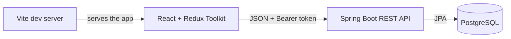

# DSA Sprint

[](https://github.com/licherover9000/dsa-sprint/actions/workflows/ci.yml)

**A full-stack practice tracker for turning daily DSA problems into visible progress.** Log solved problems, keep approach notes, track your POTD streak, and revisit problems with a spaced review queue.

> This is a learning project. The source repository is public; a hosted service is not deployed yet. Read [Public launch checklist](docs/PUBLIC_LAUNCH.md) before putting real users or real data on a public deployment.

## What it does

- Account registration and login using BCrypt password hashing and JWT authentication.
- Private, per-account problem logs for LeetCode and GeeksforGeeks.
- Difficulty and category tracking, approach notes, and problem links.
- A POTD streak counter and a GitHub-style activity heatmap.
- A review queue with 7-day and 14-day reminders.
- Docker Compose for local development and GitHub Actions to build both apps.

## Run it on your computer

The easiest path uses Docker Desktop and PowerShell. Docker Compose starts the frontend, API, and PostgreSQL database together.

1. Install [Docker Desktop for Windows](https://docs.docker.com/desktop/setup/install/windows-install/) and open it. Wait until Docker says it is running.
2. Open PowerShell in this repository's folder.
3. Create a random JWT signing key for this local install:

   ```powershell
   .\scripts\setup.ps1
   ```

4. Build and start the app:

   ```powershell
   docker compose up --build
   ```

5. Open [http://localhost:5173](http://localhost:5173) and create an account.

Keep that terminal open while you use the app. Press **Ctrl+C** to stop it, then run `docker compose down`. The database volume keeps your local data between starts. The generated `.env` file is ignored by Git; never commit it.

To run the frontend and backend directly, follow [Run without Docker](docs/LEARNING_ROADMAP.md#run-without-docker).

## How the parts connect



| Part | Technology | Folder |
| --- | --- | --- |
| User interface | React, Vite, Redux Toolkit, Axios | `frontend/` |
| API | Java 17, Spring Boot, Spring Security, JPA | `backend/` |
| Database | PostgreSQL | `docker-compose.yml` |
| Build automation | GitHub Actions | `.github/workflows/ci.yml` |

## API overview

After registering or logging in, send the returned JWT as `Authorization: Bearer <token>`.

| Method | Route | Purpose |
| --- | --- | --- |
| `POST` | `/api/auth/register` | Create an account |
| `POST` | `/api/auth/login` | Get a JWT |
| `GET` | `/api/auth/me` | Get the signed-in profile |
| `POST` | `/api/submissions` | Log a problem |
| `GET` | `/api/submissions` | List your problems |
| `GET` | `/api/submissions/streak` | Get your POTD streak |
| `GET` | `/api/submissions/heatmap` | Get daily solve counts for one year |
| `GET` | `/api/submissions/review` | List problems in your review queue |
| `PATCH` | `/api/submissions/{id}/review` | Add or remove a review reminder |

All submission data is scoped to the account from the verified token. The streak counts distinct POTD dates, beginning today or yesterday if today has no POTD entry.

## Learn the project

The code is easier to learn by following one request through each layer. Start with the [study roadmap](docs/LEARNING_ROADMAP.md), which explains the folders, gives short exercises, and lays out a path from beginner changes to larger features.

## Resume notes

See [resume project entry](docs/RESUME.md) for accurate, copy-ready wording. Make sure you can explain each bullet and demo the app before listing it.

## Contributing

Issues and pull requests are welcome. Start with [CONTRIBUTING.md](CONTRIBUTING.md). The project is licensed under the [MIT License](LICENSE).
